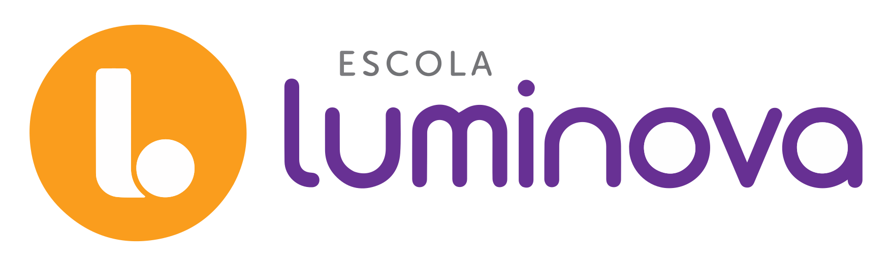

# Luminova Digital — Design System

Sistema de design **100% digital** para a **Escola Luminova Interlagos**, uma escola K-12 em São Paulo. Cobre site institucional, plataforma do aluno, e-mails marketing/transacionais, redes sociais e materiais digitais.

A identidade visual deriva do sistema da agência LIT (2024): **roxo + laranja** como paleta principal, com **cores por segmento escolar** (Fundamental 1, Fundamental 2, Ensino Médio, Professores) que diferenciam contextos no produto.

> Este sistema **não cobre material impresso**. Cantos arredondados, estilo flat, blobs orgânicos e tipografia generosa são marcas da expressão digital.

---

## Sources

Materiais fornecidos pelo cliente (todos em `uploads/` e copiados para `assets/`):

| Arquivo original | Destino | Uso |
|---|---|---|
| `Group 1.png` | `assets/luminova-mark.png` | Marca circular (roxo + laranja) — favicon / avatar |
| `Logo Luminova.svg` | `assets/Logo Luminova.svg` | Lockup completo (logo + wordmark) em arte de apresentação |
| `Luminova Logo 01 png.svg` | `assets/Luminova Logo 01.svg` | Marca principal vertical |
| `Luminova Logo 02 png.svg` | `assets/Luminova Logo 02.svg` | Marca principal alternativa |
| `luminova_hor.svg` | `assets/luminova-horizontal.svg` | Logo horizontal (header, e-mails) |
| `Logo Luminova Interlagos (1).svg` | `assets/Logo Luminova Interlagos.svg` | Lockup completo com cidade "Interlagos" |

Nenhum codebase, Figma ou deck adicional foi fornecido — todas as decisões partem das diretrizes textuais e dos arquivos de marca acima.

---

## Quick index

```
README.md                    ← este arquivo
SKILL.md                     ← invocação como Agent Skill
colors_and_type.css          ← tokens de cor e tipografia (CSS vars)
assets/                      ← logos, marca, imagens
preview/                     ← cards do Design System tab
ui_kits/
  ├─ website/                ← site institucional (landing, vestibular, sobre)
  └─ student-platform/       ← plataforma do aluno (login, dashboard, aula)
```

---

## Brand snapshot

- **Nome:** Luminova Interlagos · Escola K-12
- **Localização:** São Paulo, bairro de Interlagos
- **Audiência:** famílias, alunos do 1º ao 12º ano, professores
- **Idioma:** Português brasileiro (PT-BR)
- **Personalidade:** acolhedora, contemporânea, otimista, séria sem ser engessada
- **Inspiração visual:** sistema LIT 2024 — flat, geométrico, com blobs orgânicos como elemento gráfico

---

## CONTENT FUNDAMENTALS

### Voz e tom

A comunicação Luminova é **direta, calorosa e em português brasileiro contemporâneo**. Não é institucional-burocrática nem coloquial demais — é a voz de uma escola moderna que respeita famílias e alunos como interlocutores capazes.

| Faceta | Como soa |
|---|---|
| Direção | Quase sempre **"você"** (singular) com famílias e alunos. **"Nós"** para a escola. Evitamos "a Luminova oferece..."; preferimos "Aqui na Luminova, você encontra...". |
| Formalidade | Formal mas próximo. Sem "prezado(a)". Sem gírias. |
| Comprimento | Frases curtas. Um parágrafo nunca passa de 3 linhas no mobile. |
| Pronomes para alunos | "você" — nunca "a criança", "o jovem" de forma distante. |
| Pronomes para professores | "professor / professora" ou "educador / educadora". |

### Casing

- **Títulos:** Sentence case sempre. Ex.: *"Matrículas abertas para 2026"*, NUNCA *"Matrículas Abertas Para 2026"*.
- **Eyebrows:** UPPERCASE com letter-spacing (`0.12em`). Ex.: `MATRÍCULAS 2026`, `ENSINO MÉDIO`.
- **Botões:** Sentence case. *"Agendar visita"*, *"Quero conhecer"*, *"Entrar"*.
- **Links de navegação:** Sentence case, curtos. *"Sobre nós"*, *"Pedagogia"*, *"Vestibular"*.

### Exemplos de copy (drop-in)

**Hero institucional**
> Eyebrow: `MATRÍCULAS ABERTAS · 2026`
> Título: *Uma escola pensada para os próximos 12 anos da sua família.*
> Sub: *Da alfabetização ao vestibular, com método próprio e turmas pequenas. Em Interlagos, São Paulo.*
> CTA: *Agendar visita*

**Card de segmento**
> Eyebrow: `FUNDAMENTAL 1` (em turquesa)
> Título: *Anos 1 ao 5 · A base que sustenta tudo.*
> Texto: *Alfabetização, autonomia e curiosidade num ambiente que respeita o tempo de cada criança.*

**E-mail transacional (matrícula)**
> Olá, [Nome]!
> Sua pré-matrícula chegou aqui. Em até 2 dias úteis, nosso time entra em contato pra agendar a próxima etapa.
> Qualquer dúvida, responde esse e-mail — a gente lê.
> — Equipe Luminova Interlagos

**Push da plataforma do aluno**
> *Nova atividade de Matemática · Profª Camila publicou agora.*

### O que evitar

- ❌ "Excelência educacional", "soluções pedagógicas", "ambiente que prima por..." (corporativês escolar).
- ❌ Emoji em copy institucional (site, e-mails formais). Permitido **com parcimônia** em redes sociais.
- ❌ Pontos de exclamação em série. Um, no máximo, e só em CTAs ou push.
- ❌ Caps em frases inteiras (exceto eyebrows e badges).
- ❌ Anglicismos quando há equivalente em PT-BR (use *envio* em vez de *upload* se possível).

---

## VISUAL FOUNDATIONS

### Color

- **Paleta principal:** roxo (`#652D91`) + laranja (`#F59C00`). O roxo carrega autoridade institucional; o laranja é energia e ação (CTAs, eyebrows, highlights).
- **Cores por segmento** (`--lum-seg-*`): aparecem como acentos em headers, badges e ilustrações quando o contexto é específico de um segmento. Turquesa = Fundamental 1; laranja = Fundamental 2; roxo profundo = Ensino Médio; navy = Professores. **Não substituir** o roxo principal nem o laranja CTA — são camadas paralelas.
- **Backgrounds:** branco (`#FFFFFF`) ou roxo-suave (`#F3EFF7`) na maioria das telas. Roxo sólido (`#652D91`) reservado para footer e blocos de "destaque institucional".
- **Sem gradientes.** Cores chapadas, sempre.

### Typography

- **Display (títulos, eyebrow, botões, labels):** **Museo Sans Rounded** — fonte de marca. Defaults: **700** para títulos padrão, **900** para display oversized. Outros pesos (100/300/500/1000) disponíveis para casos específicos.
- **Body (corpo, dados, legendas):** **Manrope** via Google Fonts (`@import` em `colors_and_type.css`).
- **Arista Pro:** **não usar em UI.** Serviu apenas para construir o símbolo da logo, já vetorizado nos SVGs em `assets/`. Arquivos `-trial.ttf` em `fonts/` são apenas referência — sem licença comercial.
- **Headlines em duas cores:** eyebrow pequeno em laranja (`--lum-gold`, uppercase, letter-spacing) + título grande em roxo (`--lum-purple`). Esse pattern é assinatura da marca.
- **Hierarchy:** Display 64px → H1 48px → H2 36px → H3 28px → body 16px. Quebras agressivas; usar `text-wrap: balance` em títulos.

### Logo on colored backgrounds

A logo Luminova é **multicolorida** (roxo + laranja + branco). Para garantir contraste sobre fundos roxos ou laranjas, **nunca** aplicar filtros (`brightness(0) invert(1)` etc.) — eles transformam a logo num retângulo branco sólido.

**Backgrounds válidos:**

| Fundo | Tratamento |
|---|---|
| Branco | Logo direta |
| Roxo-suave `#F3EFF7` | Logo direta (contraste é suficiente) |
| Roxo sólido `#652D91` | **Envolver numa pílula branca** com `border-radius: 999px`, padding `12–14px / 20–22px` |

**Backgrounds a evitar:**

- ❌ **Laranja sólido (`#F59C00`).** O símbolo laranja da logo se confunde com o fundo, mesmo dentro de pílula branca. Em superfícies laranja, preferir copy + ícones, sem logo — ou aplicar a logo numa zona branca/roxa adjacente.

```html
<!-- Sobre roxo sólido: pílula branca -->
<div style="background:#fff;border-radius:999px;padding:14px 22px;display:inline-block;">
  
</div>
```

### Background & decoração

- **Blobs orgânicos** em roxo (`#9E54BD` 20–40% opacidade) e laranja (`#F59C00` 15–25%) atrás de seções hero e cards de destaque. Posicionados como elementos absolutos, levemente fora do viewport. Nunca interferem na legibilidade.
- **Sem texturas, sem ruído, sem padrões repetidos.** O sistema é resolutamente flat.
- **Sem imagens "stock genéricas"**: quando há fotografia, é de alunos / espaço da escola, calor de cor neutro a quente, alta saturação natural.

### Cards

- `border-radius: 16–24px` (mais arredondados em hero cards, menos em cards densos de lista).
- Background branco com `border: 1px solid var(--lum-border)` **OU** background `--lum-purple-soft` sem borda.
- Sombras quase ausentes: `--lum-shadow-sm` no estado normal, `--lum-shadow-md` no hover. Nunca pesadas.
- Sem borda colorida à esquerda (anti-padrão).

### Layout & spacing

- Grid 12 colunas, 1200px max-width, gutters 24px.
- Espaçamento múltiplo de 8 (`--lum-space-*`).
- Generoso vertical padding em seções hero (`--lum-space-9` = 96px desktop; 48px mobile).
- Footer **roxo sólido** (`#652D91`) ocupando toda a largura, logo em branco, links em branco/roxo-claro.

### Corner radii

| Token | Uso |
|---|---|
| `--lum-radius-sm` 6px | inputs pequenos, tags |
| `--lum-radius-md` 12px | botões padrão, badges |
| `--lum-radius-lg` 18px | cards de lista |
| `--lum-radius-xl` 24px | hero cards, modais |
| `--lum-radius-pill` 999px | chips, segment switchers |

### Borders & dividers

- Hairline `1px solid var(--lum-border)` em cards e separadores.
- **Sem inner shadows.** Sem rings duplos.

### Shadows

- `--lum-shadow-sm` em estados normais.
- `--lum-shadow-md` no hover de cards.
- `--lum-shadow-lg` reservado para modais e overlays.
- `--lum-focus-ring` (3px laranja com alpha) — **sempre** visível no focus de inputs e botões.

### Hover & press

- **Botões primários (roxo):** hover → `--lum-purple-deep` (`#4A1F6B`). Press → mesmo + `transform: translateY(1px)`.
- **Botões CTA (laranja):** hover → `--lum-gold-deep` (`#C97D00`). Press → translateY(1px).
- **Botões ghost / link:** hover → underline + cor mais escura.
- **Cards clicáveis:** hover → shadow sobe para md + `translateY(-2px)`.
- Nunca usar mudança de opacidade como único feedback (acessibilidade).

### Motion

- Easing universal: `cubic-bezier(.2, .8, .2, 1)` (`--lum-ease`).
- Durações: `120ms` (fast — hovers), `220ms` (normal — entradas), `360ms` (slow — modais).
- Fades + sutil translateY(8px → 0) para entradas. **Sem bounces.** Sem rotações decorativas. Animação serve a função.

### Transparência & blur

- Transparência usada apenas em blobs decorativos (15–40%).
- Backdrop-blur usado em modais (overlay com `rgba(101, 45, 145, 0.4)` + `backdrop-filter: blur(6px)`).
- **Não** usar glass / frosted em cards.

### Imagery

- Fotografia real, alta resolução, calor neutro a quente.
- Pessoas reais (alunos, professores). Sempre com diversidade representativa.
- **Sem b&w.** **Sem grain.** **Sem stock corporativo.**
- Quando não há foto disponível, usar **blobs roxos/laranja** como placeholder visual em vez de quadros cinza.

### Layout rules — fixed elements

- Header desktop: 80px de altura, fundo branco com `border-bottom: 1px solid var(--lum-border)`, sticky.
- Header mobile: 56px, mesmo estilo.
- Footer: roxo sólido, mínimo 320px de altura, logo branca à esquerda.
- Modais: max-width 560px, radius 24px, sombra lg, padding 32px.

---

## ICONOGRAPHY

### Approach

- **Sistema de ícones:** Lucide (CDN), estilo **linear / stroke 2px**. Combina com o tom flat e geométrico da marca.
- **Sem icon font próprio** (não foi fornecido).
- **Tamanho padrão:** 20px ou 24px. Cor herda do `currentColor` (geralmente `--lum-purple` ou `--lum-text`).
- **Stroke 2px, line caps round, line joins round.**

### Loading via CDN

```html
<!-- Lucide via CDN -->
<script src="https://unpkg.com/lucide@latest/dist/umd/lucide.js"></script>
<i data-lucide="calendar"></i>
<script>lucide.createIcons();</script>
```

> ⚠️ **Substituição flagada:** Lucide não foi especificado pelo cliente. Foi escolhido como melhor casamento visual (linear, geométrico, 2px stroke) com a estética flat/arredondada. Trocar se houver preferência por Phosphor, Heroicons, ou um set autoral.

### Emoji

- **Não usar** em superfícies institucionais (site, e-mails formais, plataforma do aluno em contexto pedagógico).
- Permitido em **redes sociais** e em **mensagens push casuais**, com parcimônia (1 por mensagem máx.).

### Unicode characters as icons

- Não usar. Sempre que possível, ícone real do Lucide.

### Logos & marca

Disponíveis em `assets/`:

| Arquivo | Quando usar |
|---|---|
| `luminova-mark.png` | favicon, avatar, marca pequena (mínimo 32px) |
| `Logo Luminova.svg` | apresentação institucional (1280×720, full lockup) |
| `Luminova Logo 01.svg` | marca principal vertical |
| `Luminova Logo 02.svg` | marca alternativa vertical |
| `luminova-horizontal.svg` | header do site, e-mails (lockup horizontal) |
| `Logo Luminova Interlagos.svg` | quando contexto exige cidade explícita |

**Regra inquebrantável:** logos nunca são desenhados via SVG inline, CSS, ou texto estilizado. Sempre ``.

---

## CAVEATS & open questions

**Fonts wired up:**
- ✅ **Museo Sans Rounded** (display) — brand font, registered as `--lum-font-display` com pesos 100/300/500/700/900/1000. Defaults: 700 para títulos, 900 para display.
- ✅ **Manrope** (body) — Google Fonts via `@import`.
- ⚠️ **Arista Pro** — presente em `fonts/` mas marcada como **logo construction only**. Não é usada em UI. Arquivos `-trial.ttf` não têm licença comercial — manter apenas como referência.

**Iconography:**
- 🟡 **Lucide** foi escolhida como icon set (linear, 2px, geometric) por casamento visual com a marca. Cliente não especificou — substituir se houver preferência por Phosphor / Heroicons / icon set autoral.

**UI kits:**
- 🟡 Nenhum codebase, Figma ou screenshots de produto foram fornecidos. Os UI kits (`ui_kits/website/`, `ui_kits/student-platform/`) são **interpretações fiéis das diretrizes** — não recreações de telas existentes. Quando o site/plataforma reais existirem, alinhar pixel-a-pixel.
- 🟡 Conteúdo (nomes, turmas, professores, matérias) é placeholder. Substituir por dados reais antes de qualquer uso público.

**Imagery:**
- 🟡 Nenhuma fotografia de aluno / escola foi fornecida. Cards de novidades usam blocos coloridos com blobs como placeholders. Precisamos de fotos reais para fechar.

**Conteúdo não coberto** (escopo digital, fora deste sistema):
- E-mail templates (HTML / MJML)
- Templates de redes sociais (Instagram, YouTube)
- Animações Lottie / motion guidelines detalhados

## **🟠 Pode dar uma olhada e me dizer?**

Esse é um primeiro corte. **Eu preciso que você me ajude a iterar:**

1. **Logo correto?** Confirme se os 5 lockups em `assets/` são todos válidos e se a hierarquia (mark / horizontal / lockup com cidade) está certa.
2. **Cores por segmento:** os matizes para F1/F2/EM/Profs estão fiéis ao sistema LIT 2024? Vi os valores no brief mas vale conferir o tom exato.
3. **Tom de voz:** os exemplos de copy (CONTENT FUNDAMENTALS) capturam o jeito Luminova? Algum termo proibido que eu deveria adicionar?
4. **UI kits:** ambos foram inventados a partir das diretrizes — você tem mockups ou um site/plataforma reais para eu calibrar?
5. **Iconografia:** Lucide é OK como icon set?

Me responda com o que ajustar e eu refino. 🟣🟠

---

## Dados institucionais

Use SEMPRE estes dados em comunicações, footers, assinaturas de e-mail e materiais oficiais. **Nunca invente endereço, telefone, CNPJ ou qualquer dado de contato.**

| Campo | Valor |
|---|---|
| Nome completo | Escola Luminova Interlagos |
| CNPJ | 50.904.622/0001-12 |
| Endereço | Rua Coronel Juliano, 111 — Interlagos, São Paulo/SP |
| Telefone | (11) 5666-8900 |
| WhatsApp | (11) 99896-5737 |
| E-mail | luminova.interlagos@luminovainterlagos.com.br |
| Site | luminovainterlagos.com.br |
| Instagram | @luminova.interlagos |
